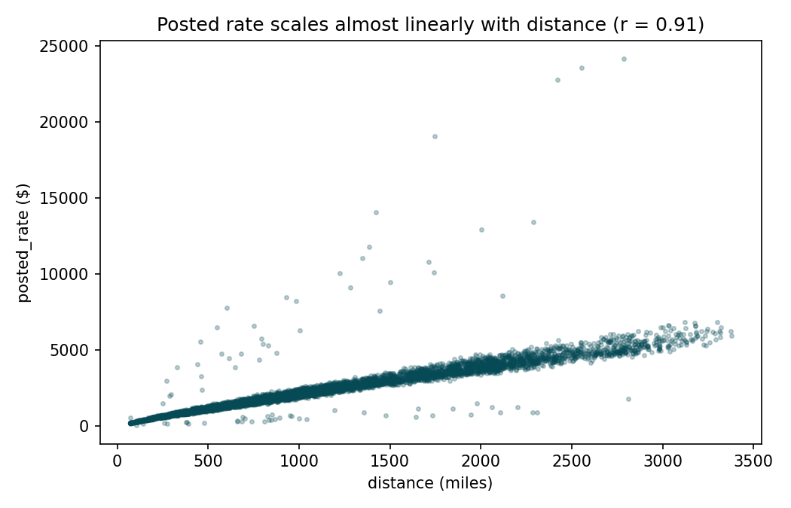
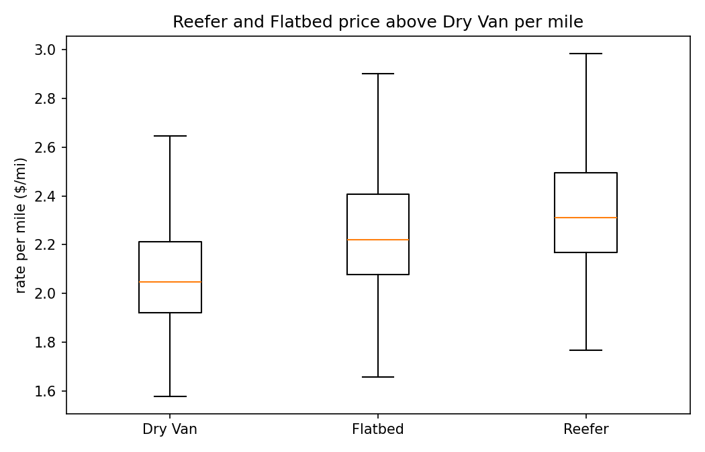
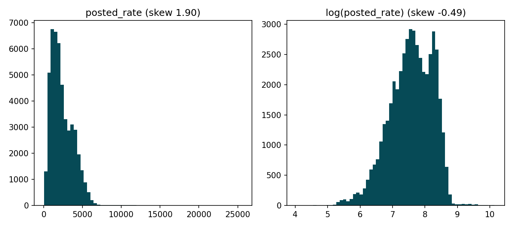
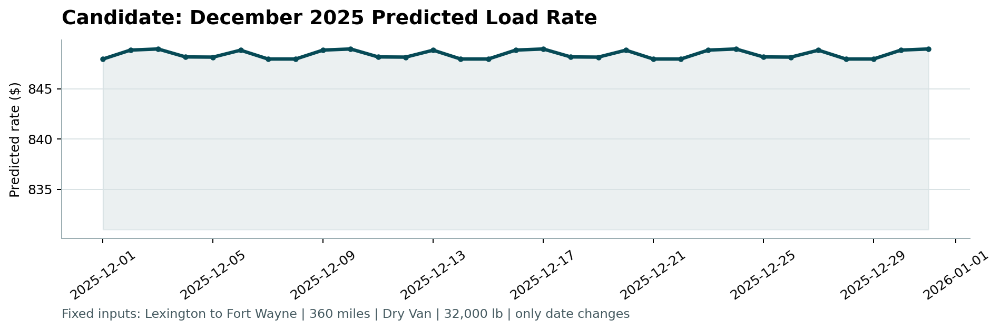

# Freight Rate Prediction — Technical Report

**Author:** ML Engineer Assessment submission
**Task:** Predict `posted_rate` (USD) for 12,000 truckload freight shipments.

---

## 1. Data overview

The labeled development set (`data/train_test.csv`) contains **48,000 loads**
spanning **1 Jan 2025 → 31 Oct 2025**. Each row describes a shipment:

| Column | Meaning |
| ------ | ------- |
| `pickup`, `delivery` | origin / destination city (64 cities each) |
| `pickup_lat/lon`, `delivery_lat/lon` | coordinates of each city |
| `distance` | billed road miles |
| `equipment` | Dry Van (57%), Reefer (25%), Flatbed (18%) |
| `weight` | shipment weight (lb) |
| `date` | pickup date |
| `market_index`, `quote_signal` | market/pricing signals |
| `posted_rate` | **target** — rate paid for the load (USD) |

The validation set (`data/validation.csv`) holds **12,000 loads from
1 Nov 2025 → 31 Dec 2025** — strictly *after* the training window. This single
fact drives the entire validation strategy (Section 4).

## 2. Key findings from exploration

- **Distance is the dominant driver.** `posted_rate` correlates with `distance`
  at **0.91**; the relationship is close to linear. Everything else is a
  second-order adjustment on top of mileage.
- **Equipment carries a clear premium.** Average rate-per-mile is **$2.12 Dry
  Van < $2.29 Flatbed < $2.38 Reefer**. Reefer (refrigerated) commands the
  highest per-mile rate, which matches real freight economics.
- **Lane matters.** The origin→destination pair is a strong regional-pricing
  proxy; it ends up the second most important feature in the model.
- **Mild upward time drift.** Mean per-mile rates rise gently through 2025
  (~$2.10 in January to ~$2.25 by autumn), plus a small mid-week bump. These are
  captured with a linear day index and cyclical month/day-of-week features.
- **The target is right-skewed** (skew ≈ 1.9). A log transform nearly
  symmetrises it (skew ≈ −0.5), which is why the model is trained on
  `log(posted_rate)`.





## 3. Data-quality issues and how they were handled

| Issue | Evidence | Handling |
| ----- | -------- | -------- |
| **Impossible weights** | 292 rows with `weight ≤ 0`, min = −47,500 lb | Clipped to a plausible freight band (1,000–48,000 lb); out-of-band values set to missing. |
| **Missing weights** | 300 train / 165 validation NaN | Left as NaN; LightGBM routes missing values natively, so no row is dropped at predict time. |
| **Missing market index** | 374 train / 249 validation NaN | Left as NaN for the model; for the December file (which has no such column) backfilled with the training median. |
| **Road vs straight-line distance** | billed `distance` ≈ 1.17× haversine | Kept billed distance as the primary feature and added haversine + a circuity ratio as secondary signals rather than overwriting it. |
| **December file has only 7 columns** | no coords / market signals | A reference table of per-city coordinates and median signals, learned at train time (`artifacts/feature_reference.json`), backfills the missing columns so the identical feature pipeline runs on it. |

All cleaning lives in `src/features.py` and runs identically for training,
validation and December — there is no train/serve skew.



## 4. Train / validation split

Because the real validation period is the **future** relative to training, a
random shuffle split would leak future information and over-state performance.
Instead the local evaluation uses a **temporal forward split**:

- Sort the 48,000 training rows by date.
- Hold out the most recent **20% by date** (Sep–Oct 2025) as a local validation
  set; train on the earlier 80% (Jan–Aug 2025).
- This mirrors the task: fit on the past, score on a later, unseen window.

Early stopping on this holdout chose **172 boosting rounds**.

After measuring performance, the model is **refit on all 48,000 rows** using
that tuned round count, so the model that scores the real Nov–Dec validation set
has seen every available date — including the most recent ones closest to the
target period.

### Holdout performance (Sep–Oct 2025)

| Metric | Value | Reading |
| ------ | ----- | ------- |
| MAPE   | 5.7%  | predictions land within ~6% of actual on average |
| MAE    | $133  | typical dollar error |
| RMSE   | $641  | penalises the few long-haul, high-rate loads |
| R²     | 0.82  | explains 82% of rate variance on unseen future dates |

## 5. Model choice and reasoning

**LightGBM gradient-boosted regression** on `log(posted_rate)`.

Why this model:

- The strongest relationship (distance→rate) is near-linear, but equipment,
  lane and market signals introduce **non-linear interactions** that a gradient
  booster captures without manual interaction terms.
- It handles the **mix of numeric and high-cardinality categorical** features
  (64×64 possible lanes) natively, and deals with **missing values** without
  imputation — directly addressing the weight/market-index gaps.
- Training the **log** of the rate makes the loss relative (better for a skewed,
  multiplicative quantity like price) and guarantees **strictly positive**
  predictions, which the scorer requires.

Feature importances (from `artifacts/training_report.json`) rank
`distance` > `lane` > `quote_signal` > `weight` > `equipment` > date features,
which lines up with the exploratory findings.

## 6. The fixed December chart

Running the provided `score.py` on the filled December inputs produces the chart
below. The inputs are fixed (Lexington → Fort Wayne, 360 miles, Dry Van,
32,000 lb) with **only the date changing**, so the plot isolates the model's
pure date/day-of-week response. Predictions sit around **$848** (≈ $2.36/mile,
consistent with the training distribution), with a small weekly oscillation
driven by the day-of-week features.



## 7. Reproducing

```bash
python -m pip install -r requirements.txt
python -m src.train
python -m src.predict
python score.py --predictions validation_predictions.csv \
                --december-predictions data/december_chart_inputs.csv
```
